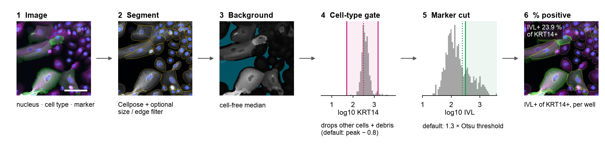
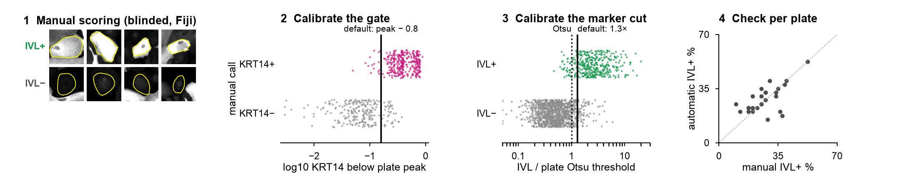

# diffquant — differentiation marker quantification

**Quantification of marker-positive cells in high-content plate images.**
diffquant segments all cells, retains only cells of the target type (the *gate*) and reports the fraction of these cells
that is positive for a marker (the *readout*), per well and per plate. All cut-offs are derived from the data of each plate;
the rules that define them are calibrated against blinded manual scoring for each experimental set-up.



## Example: keratinocyte differentiation
Primary human epidermal keratinocytes grown on mouse 3T3 feeder fibroblasts. To exclude other cell types, KRT14 is used as
a marker to identify keratinocytes; involucrin is then scored among KRT14+ cells.

| Role | Marker | Description |
|---|---|---|
| nucleus | DAPI / Hoechst | DNA stain; supports segmentation |
| cell-type gate | **KRT14** (keratin 14) | cytoskeletal keratin of basal, undifferentiated epidermal keratinocytes; feeder fibroblasts are KRT14-low |
| readout | **IVL** (involucrin) | cornified-envelope precursor protein, expressed when keratinocytes enter terminal differentiation |

Readout: **% IVL+ among KRT14+ cells per well (differentiation index).**

## Applications
> - **Differentiation screens** (compounds, siRNA/CRISPR, growth factors) in keratinocytes or other epithelial cells.
> - **Co-cultures and feeder systems** in which only one cell type is to be counted.
> - **Other "cell type × state" readouts** in 2D images, e.g. Ki67+ proliferating cells among E-cadherin+ epithelial
>   cells, or a nuclear factor within one lineage.
>
> Gate and readout markers, their rules and the number of readouts are set in the configuration file; the gate can be
> disabled to score all cells. Each application requires its own [calibration](#calibration).

## Installation
```bash
pip install "git+https://github.com/yidan-jiang/diffquant"                    # core: measurement, gating, scoring, calibration
pip install "diffquant[seg] @ git+https://github.com/yidan-jiang/diffquant"   # core + Cellpose for segmentation (GPU recommended)
```
Requires Python ≥ 3.9. Segmentation can also be performed with other software: `segmentation.masks` then points to a
folder of label images.

## Quick start (bundled example)
```bash
git clone https://github.com/yidan-jiang/diffquant && cd diffquant && pip install -e .
diffquant run examples/config.yaml                    # measure -> gate -> cut -> focus QC -> summary (bundled masks)
diffquant overlay examples/config.yaml --site B08 1   # ImageJ TIFF with outlines coloured by call
```
Expected result in `results/example/example/wells.csv`: 515 KRT14+ cells, 123 IVL+ cells, **23.9 % IVL+**.

## New datasets
```bash
diffquant init screen.yaml        # commented configuration template: plates, channels, markers, rules
diffquant inspect screen.yaml     # filter / wavelength metadata of each channel token (w1, w2, ...)
diffquant run screen.yaml         # segment -> measure -> threshold -> focus -> summarize
```
Input: one TIFF per well, site and channel. The default file pattern is that of ImageXpress / MetaMorph
(`<name>_<well>_s<site>_w<n>....tif`); for other systems, `images.pattern` accepts a regular expression with the groups
`well`, `site` and `channel`. If the channel order differs between plates, `channels:` can be set per plate.

**Segmentation model.** Any Cellpose model that segments the cells of interest reliably can be used; a few sites should be
inspected visually (`diffquant overlay`). The example used `cpsam` (Cellpose 4) on KRT14 + DAPI. Because the model
determines the cell outlines and therefore the measured intensities, a change of model requires recalibration.

## Calibration
The default cut-offs, **gate Δ = 0.8** (KRT14 cut 0.8 log10 units below the keratinocyte peak) and **readout factor = 1.3**
(IVL cut = 1.3 × Otsu threshold), were calibrated against blinded manual scoring for one set-up: the antibodies and stains, ImageXpress
configuration and exposure, and segmentation (cpsam) of the original screen. They are not transferable to other set-ups.
A change of marker, antibody, microscope, objective, exposure, medium, cell type or segmentation model requires a new
calibration; scoring takes about 2 min per plate and marker.



```bash
diffquant score-sets screen.yaml        # blinded single-cell crops per plate and marker
# Fiji: open fiji/score_cells.py, Run, select a scoring folder, press P / N / U for each cell
diffquant calibrate screen.yaml         # recommended gate Δ and readout factor; agreement curves and figure
```
Procedure and criteria: [docs/recalibration.md](docs/recalibration.md).

## Use with Claude Code or Codex
diffquant can be run with an AI coding assistant such as Claude Code or Codex; instructions for these tools are in
`AGENTS.md`. Manual scoring for calibration requires human curation.

## Outputs
Per plate (`<output>/<plate>/`): `cells_called.csv.gz` (one row per cell: area, raw and background-subtracted means,
filter, gate and readout calls), `wells.csv` (% positive per well; `valid` = sufficient gated cells), `thresholds.csv` and
`thresholds.png`, `focus.csv`, `site_background.csv`. Across plates: `wells_all.csv`, `thresholds_all.csv`; with a plate map,
additionally `conditions_per_plate.csv`, `delta_per_plate.csv` and `delta_summary.csv`. Column reference:
[docs/outputs.md](docs/outputs.md).

## Method summary
1. **Segmentation** with Cellpose (cell-type marker + nucleus). An optional object filter (`filters:` minimum / maximum
   area, cells at the image border) removes debris and cell clumps before gating; it is disabled by default.
2. **Measurement** of the mean intensity of each channel in each cell, minus the background. **Background** of a site
   (image field) = median of its cell-free pixels (> 15 px from any cell). In dense fields, where < 20 % of the image is
   cell-free, these few pixels lie mostly in cell halos and overestimate the background; such sites therefore use the
   median background of the sparser sites (≥ 20 % cell-free) of the same plate.
3. **Gate**, per plate, on log10 intensity: cut = main peak − Δ (default Δ = 0.8). Objects without the cell-type marker
   (other cell types, debris) fall below the gate; objects far above the population (> median + 4 MAD) are excluded.
4. **Readout cut**, per plate, among gated cells: factor × Otsu threshold of the log10 intensities (default factor = 1.3).
   The defaults derive from the original calibration; each dataset requires its own ([Calibration](#calibration)).
5. **% positive** per well; wells with < 200 gated cells are flagged. Optionally, the difference from the vehicle on the
   same plate, with plate as the replicate (two-sided one-sample t-test, Benjamini–Hochberg correction).
6. **Quality control**: focus score per site, outline overlays, blinded scoring for calibration.

Details: [docs/method.md](docs/method.md). Cluster use: [docs/slurm.md](docs/slurm.md).

## Commands
`init` · `inspect` · `plates` · `segment` · `measure` · `threshold` · `focus` · `summarize` · `run` · `score-sets` ·
`calibrate` · `overlay`; options: `diffquant <command> -h`.

## Citation and licence
MIT licence. Citation details: `CITATION.cff`.
