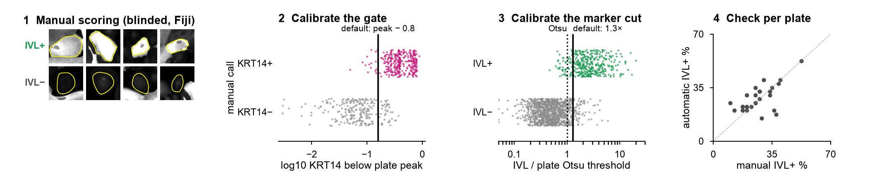

# Recalibration guide

**The default cut-offs are not universal.** In the example, gate Δ = 0.8 (KRT14) and readout factor = 1.3 × Otsu threshold (IVL)
were chosen against blinded manual scoring for one specific set-up:

| | example calibration |
|---|---|
| cells | primary human epidermal keratinocytes on mouse 3T3 feeders, FAD medium |
| stains | KRT14 (chicken primary, AF647 secondary), involucrin (rabbit primary, AF488 secondary), DAPI |
| imaging | ImageXpress wide-field, 0.648 µm/pixel, fixed exposure per channel, 16-bit |
| segmentation | Cellpose 4 `cpsam` on KRT14 + DAPI |
| background | cell-free median rule (15 px, 20 %) |
| manual scoring | one scorer, blinded; **583 KRT14 cells / 16 plates, 1,575 IVL cells / 26 plates** |
| result | KRT14 agreement 0.913 at Δ 0.8 (plateau 0.7–0.9); IVL bias +1.0, MAE 5.3 % points per plate at 1.3 × Otsu (bootstrap 95 % 1.3–1.75) |

*Panel 1: clear positive and negative cells from the bundled example (what the scorer sees, one at a time). Panels 2–4: the calibration of the original screen (every scored cell placed at its intensity, coloured by the manual call; calls not distributed). The cuts are set where the manual calls switch from negative to positive.*

## When to recalibrate
Recalibrate whenever any of these changes: marker or antibody (clone, lot with visibly different staining), secondary /
fluorophore, microscope, objective or binning, exposure or gain, cell type or culture system (feeders, density, medium),
segmentation model or its inputs, background settings. If only plate-to-plate brightness changes, no recalibration is
needed — the rules are relative to each plate (peak, Otsu).

## How
1. **Run the pipeline** on the calibration plates with provisional values (the defaults are suitable):
   `diffquant run my.yaml`. Use ≥ 5 plates (ideally 10–20) that span the experimental conditions: low and high marker levels,
   dense and sparse wells, all cell lines.
2. **Make blinded scoring sets**: `diffquant score-sets my.yaml`
   - readout set per plate: 100 gated cells — 6 per readout-intensity decile (60) + 40 unstratified random cells,
     at most one per site, so fewer on plates with < 40 sites (+ 10 repeats). The decile-stratified cells give the per-plate manual % positive (each decile
     weighted equally, which undoes the stratification); the random cells add an unweighted check of cell-level agreement;
   - gate set per plate: 60 cells in 5 bands below the gate peak, 12 each (+ 8 repeats) — covers the boundary between
     cell types.
   About 2 min of scoring per plate and marker (median 0.9 s per cell in the example calibration). Sizes are set with
   `--per-decile`, `--n-random` and `--per-band`; the example calibration used 4 per decile + 20 random and 8 per band.
   Crops are background-subtracted, shown at a fixed display range, in random order, without values.
3. **Score in Fiji**: open `fiji/score_cells.py` in Fiji (drag onto the Fiji bar) → *Run* → choose one folder in
   `<output>/scoring/` → enter the scorer's initials. Press **P** (positive), **N** (negative), **U** (unsure), **B** (back),
   **O** (outline on/off). Every call is saved immediately to `calls_<initials>.csv`; re-running resumes.
   Decide from the stain inside the outline only. Score the gate sets with the cell-type criterion (is this cell of the
   type?), the readout sets with the marker criterion. Do not adjust brightness/contrast.
4. **Calibrate**: `diffquant calibrate my.yaml [--scorer JY] [--exclude plateX]`
   - readout: per plate, manual % positive (decile-weighted, unsure = 0.5) vs the rule % on the same cells for factor
     0.80–2.00 → bias and mean absolute error; recommended factor = minimum MAE (bootstrap over plates for stability);
   - gate: agreement of `rel > −Δ` with the calls for Δ = 0.40–1.20 → recommended Δ = middle of the plateau;
   - repeat consistency of the scorer.
   Output in `<output>/calibration/`: curves, per-plate tables, `calibration_summary.json`, `calibration.png`.
5. **Write the values** into the config (`gate.delta`, `readouts[].factor`) and re-run `diffquant threshold`.
6. **Check**: `diffquant overlay my.yaml --n-sites 5` and look at the outlines in Fiji.

## Good practice
- Score with at least two people on a subset; report the agreement.
- Keep the calibration plates' calls with the project (they document the cut-offs).
- If the MAE curve has no clear minimum, or plates disagree strongly (max error > 15 % points), the marker may not be
  bimodal enough for a positive/negative call — consider a fixed cut (`rule: fixed`) or report mean intensity instead.
- Very low or very high positive fractions can be genuine biology. The Otsu threshold, however, assumes two populations:
  if nearly all gated cells are negative (or positive), it can fall inside the single population. Plates with
  < 2 % or > 95 % positive cells are therefore flagged (`<marker>_check_histogram` in `thresholds.csv`) for a visual check of
  `thresholds.png` and `diffquant overlay`. If the histogram is unimodal, use a fixed cut (`rule: fixed`) taken from the
  calibrated cut on bimodal plates of the same set-up; a fixed value is comparable only between plates with the same
  staining and exposure, so confirm it on the overlays.
